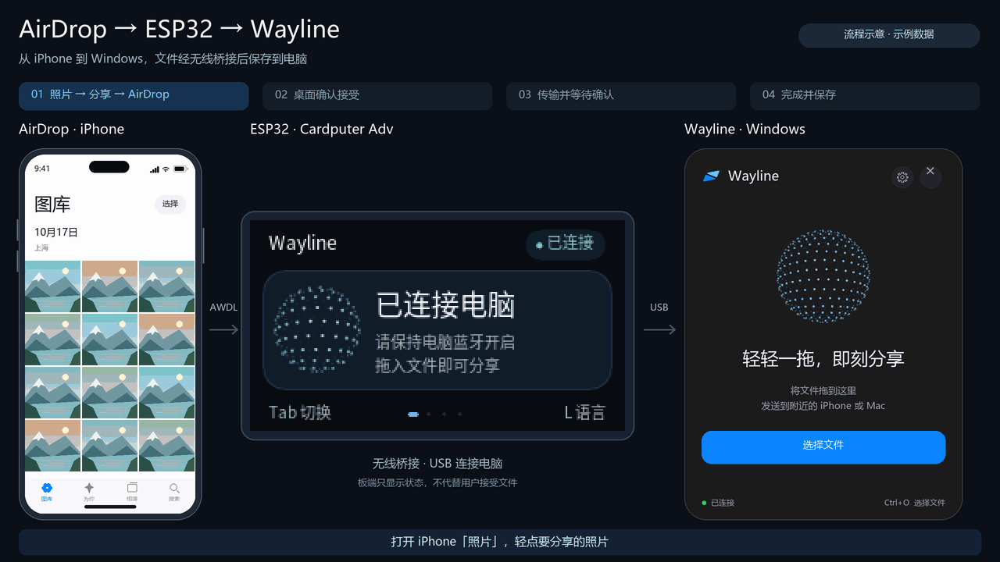
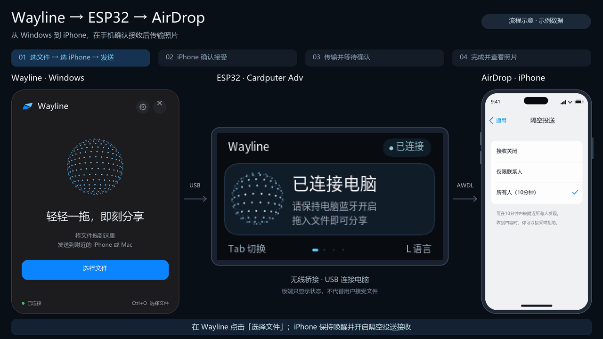

# Wayline

AirDrop between Windows and Apple devices through a USB-attached ESP32. The desktop app,
service, AirDrop core and firmware use Rust. AWDL and AirDrop use the pinned Owly crates.

The default Rust AWDL backend based on Owly 0.4.0 is included in the Windows host build.
It uses the existing ESP32 firmware protocol and Wintun and awaits device interoperability testing.
See the [development guide](docs/DEVELOPMENT.md#rust-awdl-backend).

Supports Windows 10/11 x64 and M5Stack Cardputer Adv (ESP32-S3, native USB Serial/JTAG,
2.4 GHz channel 6). The PC needs Bluetooth LE advertising; ESP32 handles Wi-Fi traffic.

A headless firmware build is available for ESP32-S3 and ESP32-C5 boards using UART0 USB-UART
or native USB Serial/JTAG. Desktop packages can include these profiles and select the matching link.
It switches at runtime between channel 6 (2.4 GHz) and channels 44 and 149 (5 GHz) on host
request, and its raw transmit rate is fixed to HE20/MCS0. C5 AirDrop interoperability and
throughput still need device validation. See the
[development guide](docs/DEVELOPMENT.md#headless-esp32-c5-build) for building and flashing it.

S3 profiles use an 8 MiB image and partition layout on both 8 MiB and 16 MiB boards;
the extra capacity is unused, and 4 MiB boards are not supported by these profiles.

[中文说明](README.zh-CN.md) · [Quick start](docs/QUICKSTART.md) · [Development guide](docs/DEVELOPMENT.md)

[](https://www.youtube.com/watch?v=8IJywijJMYU)

## Engineering

- **Native desktop and Windows integration**: GPUI transfer UI, tray, Explorer context menus
  and drag-and-drop, with an unelevated UI separated from the privileged service.
- **Rust transfer core**: discovery, TLS/HTTP and CPIO/DVZip codecs shared by desktop and CLI,
  with streaming, archive validation, final confirmation, cancellation and failure cleanup.
- **Service and firmware maintenance**: named pipes and session leases coordinate clients,
  radio lifecycle and exclusive serial access. Flashing isolates wireless work and verifies
  images and device startup before restoring readiness.
- **Embedded application**: Rust ESP32-S3 application and three-language Cardputer UI,
  a shared allocation-free CRC/COBS protocol, C/C++ hardware drivers and simultaneous
  send/receive feedback. A headless ESP32-C5 profile reuses the same protocol layer.
- **Builds and verification**: pinned Owly sources, adaptations and flashing tools, verified
  firmware and offline packages, host regression tests, protocol tests and UI previews.

## Interface and transfer demos

Demos use the actual firmware renderer with simulated transfers. Phone and desktop panels
are illustrative.

### ESP32 interface


Status, sharing guide, preferences, sound settings and three-language switching.

### Apple → Windows



### Windows → Apple



## Install and use

1. Extract the Windows x64 artifacts and start the desktop/service binaries manually; the Rust installer migration is in progress.
2. Connect Cardputer Adv with a data cable. Click the Device firmware icon at the top of the sharing card, select its port and board,
   then install or update the firmware.
3. Enable Bluetooth on the PC. Enable Wi-Fi and Bluetooth on iPhone and set
   AirDrop to Everyone for 10 Minutes.
4. Drop files into Wayline and select a recipient. Accept incoming transfers in Wayline.

The package includes firmware, flashing tools and runtime libraries; no development tools
or runtime downloads are needed. Run desktop without elevation so Explorer drag-and-drop works.
Before updating, finish transfers, quit Wayline from the tray, and close CLI commands.

- Received files default to Downloads/Wayline; change the folder in Settings. Desktop and CLI
  share the device name, identity and save directory.
- Receive results can appear in a separate, dismissible desktop notification window. Settings lets
  you enable or disable it, choose among six screen positions, and set a 3–30 second dismissal delay.
- Active send and receive cards show smoothed transfer speed and elapsed time. Timing starts
  when data transfer begins, includes final confirmation, and excludes preparation and acceptance waits.
- The history icon at the top of the sharing card opens Recent transfers with up to 200 results.
  The compact list shows device, outcome, file overview, size and time. Details shows the complete
  file list, transferred bytes, duration, average speed, radio band/channel and transfer mode,
  and each file's location. Records retain sent source paths and successful receive
  paths without file contents; older records may have no file details.
- Delete individual records or clear the history with confirmation every time. Also delete files
  and Remember this option are initially unchecked. Deleting files permanently removes the sent
  source files and received files in those records. Remembering updates the file-deletion default,
  also available in Settings; future deletions still require confirmation.
- Overflowing pages, lists and long text show a persistent proportional scrollbar, with fixed actions kept visible.
- Settings shows the identified board and supported radio channels: ESP32-S3 supports 2.4 GHz
  channel 6; ESP32-C5 also supports 5 GHz channels 44 and 149. CLI commands are `radio status`
  and `radio set`; see the [development guide](docs/DEVELOPMENT.md#cli-and-radio-diagnostics).
- The desktop language dropdown supports Simplified Chinese, Traditional Chinese, English,
  Japanese, Korean, French, German and Spanish. The choice is saved locally and updates the
  tray, system dialogs and Explorer entries.
- Uploading to 100% still requires receiver confirmation. Delivered means sending succeeded.
- Pin keeps the sharing card visible when it loses focus. Settings controls drag activation
  and opening the received file's location after success; both are enabled by default.
  Preference errors are shown on the card, and failed saves keep the previous value.
- × or Esc hides the card while receiving continues. Tray Quit or `Ctrl+Q` ends this client's
  tasks; the service stays active while another CLI session uses it.

First installation replaces the board's program and partition layout. Preserving settings
requires recognizable Wayline firmware and an identical layout. See the
[quick start](docs/QUICKSTART.md) for board controls and troubleshooting.
CLI arguments, JSON output and exit codes are in the
[development guide](docs/DEVELOPMENT.md#cli-and-radio-diagnostics).

## Build from source

Follow the [Windows / Linux setup](docs/SETUP.md) to install native tools, then run from the
repository root:

```sh
cargo run --locked -p wayline-tools -- host-build --release
```

This builds the portable host crates. The Windows-only offline package, verified Wintun,
firmware bundle and service installation remain documented separately in the
[development guide](docs/DEVELOPMENT.md).

Use the Cargo commands in [unified packaging](docs/PACKAGING.md) to include firmware and flashing tools.

The cross-platform terminal interface provides board selection, host Debug/Release builds,
packaging, verification and live logs through the same Rust commands:

```sh
cargo run --locked -p wayline-tools -- tui
```

Press `L` in the TUI to switch Chinese / English, or add `--lang en-US` to start in English.

Omit `--release` for Debug builds. Host tests do not need ESP-IDF; flashable firmware needs
ESP-IDF and Rust `esp`, checked with `cargo run --locked -p wayline-tools -- firmware-check`.
Linux supports shared-library, CLI and firmware development; desktop, Windows services and
the Wintun bridge are not ported.

## Source layout

| Path | Purpose |
| --- | --- |
| `apps/desktop`, `apps/cli` | GPUI desktop and CLI entry points |
| `apps/bridge`, `crates/wayline-awdl` | Rust AWDL child, ESP32 serial and Wintun integration |
| `vendor/owly-awdl`, `vendor/owly-airdrop` | Pinned AWDL and AirDrop protocol implementations |
| `crates/wayline-service` | Service, radio lifecycle, sessions and maintenance |
| `crates/wayline-core`, `crates/wayline-host`, `crates/wayline-flash` | Transfers, shared preferences and firmware operations |
| `crates/wayline-tools` | Cross-platform Cargo build and test orchestration |
| `crates/wayline-proto`, `crates/wayline-board`, `crates/wayline-radio`, `crates/wayline-transport` | Shared protocol, board feedback and transport adapters |
| `firmware` | Independent Rust/ESP-IDF project; hardware interfaces in `firmware/components/radio` |
| `scripts`, `assets/branding` | Categorized [asset generators and preview scripts](scripts/README.md), and [branding assets](assets/branding/README.md) |

## Credits

Thanks to the authors, maintainers and contributors of:

- [omdrop-owl-windows](https://github.com/dantdmdarealguy/omdrop-owl-windows) (dantdmdarealguy):
  implementation foundation for the Windows OWL port, Wintun integration and ESP32 radio bridge.
- [owly](https://github.com/t4t5/owly) (t4t5): Linux radio backend and fixed-channel approach.
- [omdrop](https://github.com/netmojo-systems/omdrop-plugin),
  [omdrop-awdl](https://github.com/netmojo-systems/omdrop-awdl) (Brent Kearney and contributors)
  and [OpenDrop](https://github.com/seemoo-lab/opendrop) (SEEMOO): AirDrop protocol and transfer references.
- [OWL / Open Wireless Link](https://github.com/seemoo-lab/owl) (Milan Stute, SEEMOO / TU Darmstadt)
  and [jedbillyb/owl](https://github.com/jedbillyb/owl): userspace AWDL implementation.
- [Windfall](https://github.com/UvejsGj/Windfall) (UvejsGj): DVZip format research.
- [GPUI](https://gpui.rs/) (Zed) and [Wintun](https://www.wintun.net/) (WireGuard):
  desktop UI and virtual network interface.
- [ESP-IDF](https://github.com/espressif/esp-idf), [esptool](https://github.com/espressif/esptool)
  (Espressif), [espup](https://github.com/esp-rs/espup) (esp-rs),
  [M5Unified](https://github.com/m5stack/M5Unified) and [M5GFX](https://github.com/m5stack/M5GFX)
  (M5Stack): firmware tools and hardware support.
- [Noto CJK](https://github.com/notofonts/noto-cjk): board fonts; see
  [font-source.txt](firmware/assets/font-source.txt) and [OFL.txt](firmware/assets/OFL.txt).

## Community links

- [LINUX DO Community](https://linux.do/)

## License

See [LICENSE](LICENSE). Release packages include dependency licenses and notices.
