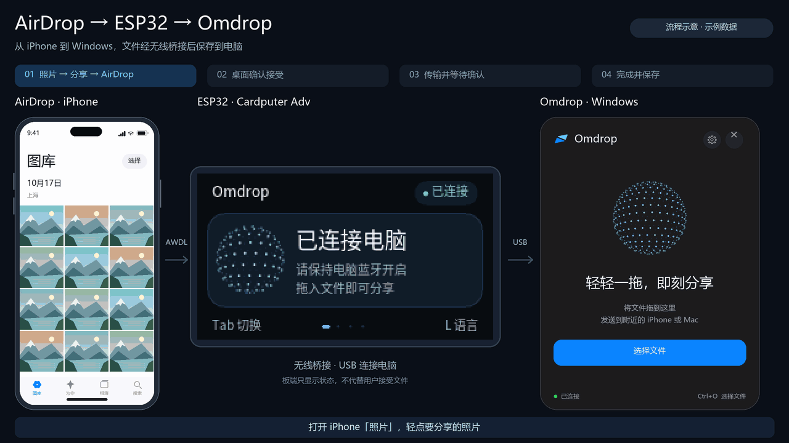
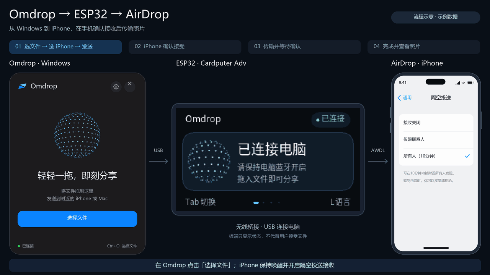

# omdrop-windows

通过 USB 连接的 ESP32，在 Windows 与 Apple 设备之间收发 AirDrop 文件。桌面应用、服务、AirDrop 核心和固件使用 Rust，AWDL 由 Owly Rust 桥接程序提供；AirDrop 协议和状态机统一使用 owly-airdrop。

支持 Windows 10/11 x64 和 M5Stack Cardputer Adv（ESP32-S3、原生 USB Serial/JTAG、2.4 GHz 信道 6）。电脑需要蓝牙 LE 广播能力，Wi-Fi 收发由 ESP32 承担。

同时支持无屏幕 ESP32-S3（8 MiB Flash profile）和 ESP32-C5 开发板，可分别选择 USB-UART/UART0 或原生 USB Serial/JTAG 固件 profile。桌面离线包可包含这些 profile；固件页按板型和 USB 接口选择。C5 按主机请求在 2.4 GHz 信道 6 与 5 GHz 信道 44、149 之间运行时切换，原始发送速率固定为 HE20/MCS0。C5 的 AirDrop 互通与吞吐仍需实机验证，构建与刷写见[开发指南](docs/DEVELOPMENT.zh-CN.md#无屏幕-esp32-c5-构建)。

[English](README.md) · [快速开始](docs/QUICKSTART.zh-CN.md) · [开发指南](docs/DEVELOPMENT.zh-CN.md)

## 工程实现

- **原生桌面与系统集成**：使用 GPUI 构建收发界面，接入托盘、文件右键与资源管理器拖放；普通权限 UI 与高权限服务分离，兼顾桌面交互和设备管理。
- **Rust 收发核心**：将设备发现、TLS/HTTP 和 CPIO/DVZip 编解码组织为桌面与 CLI 共用的模块，采用流式处理、归档校验和最终确认，支持取消与失败清理。
- **服务与固件维护**：通过命名管道和会话租约协调多个客户端，管理无线后端生命周期与串口互斥；烧录期间隔离无线任务，写入后执行镜像校验和启动检查。
- **嵌入式应用**：使用 Rust 实现 ESP32-S3 应用与 Cardputer 三语言界面，共享无堆分配的 CRC/COBS 协议；C/C++ 层封装硬件驱动，板端显示双向传输状态。无屏幕的 ESP32-C5 构建复用同一协议层。
- **构建与验证**：固定 Owly 源码、适配和烧录工具版本，校验固件及离线发布包，提供主机回归测试、协议测试和界面预览工具。

## 界面与收发演示

演示使用实际固件渲染器和模拟传输数据，手机与桌面面板为界面示意。

### ESP32 界面


状态、分享指南、偏好与声音设置，以及三语言切换。

### Apple → Windows



### Windows → Apple



## 安装与使用

1. 解压完整 Windows x64 离线包，双击 `install.cmd`，按提示允许安装后台服务。
2. 用数据线连接 Cardputer Adv，点击分享卡片顶部的设备固件图标，选择串口和板型，完成安装或更新。
3. 电脑打开蓝牙；iPhone 打开 Wi-Fi 和蓝牙，将 AirDrop 设为“所有人（10 分钟）”。
4. 拖入文件并选择接收设备；接收时在 Omdrop 中确认接受。

安装包包含固件、烧录工具和运行库，无需安装开发工具或临时下载依赖。桌面请以普通权限运行，确保资源管理器拖放可用。更新前先完成传输，从托盘退出 Omdrop，并结束 CLI 命令。

- 接收文件默认保存到下载目录的 `Omdrop` 文件夹，可在设置中更改；桌面与 CLI 共用名称、身份和保存目录。
- 接收结果可显示为独立于分享面板的桌面通知窗口；设置中可启用或关闭通知，选择六种屏幕位置及 3–30 秒消失时间，窗口带淡入淡出过渡。
- 活动发送与接收卡片显示平滑传输速度和耗时；耗时从实际开始传输算起，包含最终确认，不包含准备和等待接受。
- 分享卡片顶部的历史图标可打开“最近传输”，保留最多 200 条结果。列表显示设备、结果、文件概览、大小和时间；点击“详情”查看完整文件清单、传输量、耗时、平均速度、无线频段、信道和传输模式，并打开各文件所在位置。记录保留发送源路径和成功接收文件路径，不保存文件内容；旧记录可能没有文件明细或无线信息。
- 可删除单条记录或清空记录，每次均需确认。“同时删除文件”和“记住此选项”初始均不勾选；同时删除会永久删除记录中的发送源文件和接收文件。记住后会更新“同时删除文件”的默认值，也可在设置中修改，之后删除仍须确认。
- 页面、列表和长文本超出可视区时显示常驻比例滚动条，底部固定操作保持可见。
- 设置页可查看已识别板型并切换受支持的频段和信道；ESP32-S3 支持 2.4 GHz 信道 6，ESP32-C5 另支持 5 GHz 信道 44、149。CLI 可用 `radio status` 和 `radio set`，详见[开发指南](docs/DEVELOPMENT.zh-CN.md#cli-与串口诊断)。
- 桌面界面提供语言下拉框，支持简体中文、繁體中文、English、日本語、한국어、Français、Deutsch 和 Español；选择保存在本机，托盘、系统对话框和资源管理器入口随之更新。
- 上传达到 100% 后仍需等待接收端确认，“已送达”才代表发送成功。
- × 或 Esc 隐藏卡片，接收继续运行；托盘“退出 Omdrop”或 `Ctrl+Q` 结束本客户端任务。其他 CLI 会话仍在使用时，后台继续运行。

首次烧录、保留设置更新、板载按键和常见问题见[快速开始](docs/QUICKSTART.zh-CN.md)。CLI 参数、JSON 输出与退出码见[开发指南](docs/DEVELOPMENT.zh-CN.md#cli-与串口诊断)。

## 从源码构建

准备[开发环境](docs/DEVELOPMENT.zh-CN.md#构建与测试)后，从仓库根目录的 PowerShell 执行：

```powershell
scripts/build-release.ps1
```

输出位于 `target/release`，包含默认的 `omdrop-bridge.exe` 和经过校验的 Wintun。开发者安装使用管理员终端运行 `scripts/install-service.ps1`；固件构建（含无屏幕的 ESP32-C5 构建）、测试和离线打包见[开发指南](docs/DEVELOPMENT.zh-CN.md)。

单独构建 Rust AWDL 后端：`scripts/build-bridge.ps1 -Test`。
它使用现有 ESP32 固件协议和 Wintun，已设为源码及发布包默认，尚待设备互通验收。
构建及运行方式见[开发指南](docs/DEVELOPMENT.zh-CN.md#rust-awdl-后端)。

## 目录结构

| 路径 | 内容 |
| --- | --- |
| `apps/desktop`、`apps/cli` | GPUI 桌面与命令行入口 |
| `apps/bridge`、`crates/omdrop-awdl` | Rust AWDL 子进程、ESP32 串口与 Wintun 适配 |
| `vendor/owly-awdl`、`vendor/owly-airdrop` | 固定版本的 AWDL 与 AirDrop 协议实现 |
| `crates/omdrop-service` | 服务、无线后端管理、会话与维护 |
| `crates/omdrop-core`、`crates/omdrop-host`、`crates/omdrop-flash` | 文件收发、共用设置与固件操作 |
| `crates/omdrop-proto`、`crates/omdrop-board`、`crates/omdrop-radio`、`crates/omdrop-transport` | 共享协议、板端反馈与通信适配 |
| `firmware` | 独立 Rust/ESP-IDF 固件项目，硬件接口位于 `firmware/components/radio` |
| `scripts`、`tests`、`assets/branding` | 构建、诊断与[品牌资源](assets/branding/README.md) |

## 鸣谢

感谢以下项目的作者、维护者与贡献者：

- [omdrop-owl-windows](https://github.com/dantdmdarealguy/omdrop-owl-windows)（dantdmdarealguy）：Windows 端 OWL 移植、Wintun 集成与 ESP32 无线桥接的实现基础。
- [omdrop-owl](https://github.com/t4t5/omdrop-owl)（t4t5）：Linux 无线后端与固定信道方案。
- [omdrop](https://github.com/netmojo-systems/omdrop-plugin)、[omdrop-awdl](https://github.com/netmojo-systems/omdrop-awdl)（Brent Kearney 及贡献者）与 [OpenDrop](https://github.com/seemoo-lab/opendrop)（SEEMOO）：AirDrop 协议与收发实现参考。
- [OWL / Open Wireless Link](https://github.com/seemoo-lab/owl)（Milan Stute、SEEMOO / TU Darmstadt）与 [jedbillyb/owl](https://github.com/jedbillyb/owl)：用户态 AWDL 实现。
- [Windfall](https://github.com/UvejsGj/Windfall)（UvejsGj）：DVZip 格式研究。
- [GPUI](https://gpui.rs/)（Zed）与 [Wintun](https://www.wintun.net/)（WireGuard）：桌面界面与虚拟网络接口。
- [ESP-IDF](https://github.com/espressif/esp-idf)、[esptool](https://github.com/espressif/esptool)（Espressif）、[espup](https://github.com/esp-rs/espup)（esp-rs）、[M5Unified](https://github.com/m5stack/M5Unified) 与 [M5GFX](https://github.com/m5stack/M5GFX)（M5Stack）：固件工具链与硬件支持。
- [Noto CJK](https://github.com/notofonts/noto-cjk)：板载字体，来源与许可证见 [font-source.txt](firmware/assets/font-source.txt) 和 [OFL.txt](firmware/assets/OFL.txt)。

## 友情链接

- [LINUX DO 社区](https://linux.do/)

## 许可证

许可证见 [LICENSE](LICENSE)；发布包包含所用依赖的许可证与声明。
